<div align="center">

# 🏢 MyAloca
### Sistema Inteligente de Gestão de Baias Híbridas & Gêmeo Digital 3D

[](https://fastapi.tiangolo.com)
[](https://vuejs.org/)
[](https://threejs.org/)
[](https://tailwindcss.com/)
[](https://www.typescriptlang.org/)
[](https://www.python.org/)
[](https://www.sqlalchemy.org/)
[](LICENSE)

<p align="center">
  <b>Plataforma corporativa de hot-desking, alocação de postos de trabalho e gêmeo digital tridimensional para ambientes corporativos híbridos.</b>
</p>

[Visão Geral](#-visão-geral) • [Galeria Visual](#-galeria-visual-do-sistema) • [Diferenciais Técnicos](#-diferenciais-técnicos) • [Arquitetura](#-arquitetura--tecnologias) • [Instalação Rápida](#-instalação-e-execução) • [Credenciais Demo](#-credenciais-de-demonstração) • [Testes](#-testes-e-sensores-sdd)

---

</div>

## 📌 Visão Geral

O **MyAloca** resolve os desafios de alocação de espaço e rotatividade em escritórios modernos de trabalho híbrido. A solução combina um **Gêmeo Digital 3D interativo via WebGL**, **planta baixa 2D com matriz flexível e drag-and-drop**, **validação presencial por QR Code físico criptografado**, e **liberação automatizada contra no-show**, garantindo máximo aproveitamento dos recursos de facilities.

---

## 📸 Galeria Visual do Sistema

Capturas reais da aplicação em funcionamento:

### 1. Gêmeo Digital 3D do Escritório (Three.js WebGL)
> Renderização tridimensional isométrica/perspectiva com iluminação dinâmica, identificadores holográficos dos ocupantes, anéis LED de status e visualização em tempo real da ocupação do andar.
<p align="center">
  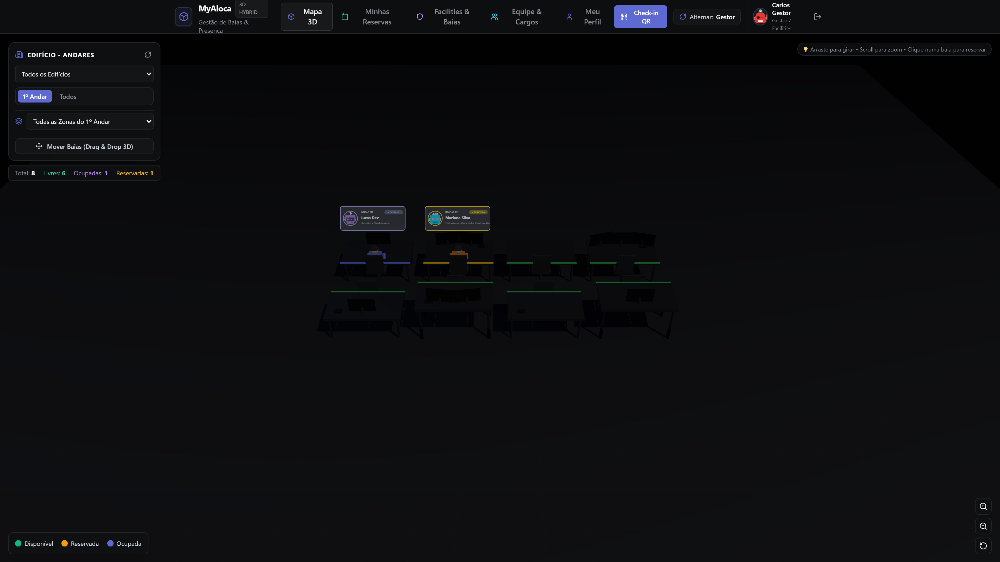
</p>

---

### 2. Detalhe da Estação de Trabalho & Ações de Gestão
> Janela modal completa com detalhes da baia, ocupante atual com foto/avatar, inventário de equipamentos instalados (monitores múltiplos, docking stations, acessórios) e botões de ação para gestores liberarem ou editarem o posto.
<p align="center">
  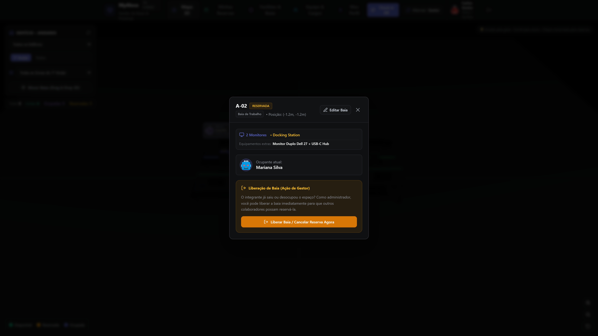
</p>

---

### 3. Planta Baixa 2D Interativa & Matriz Flexível com Drag-and-Drop
> Editor visual da planta com suporte a matrizes de baias de dimensões personalizadas ($M \times N$). Permite mover postos de trabalho entre células com drag-and-drop e adaptação automática por algoritmo de proximidade celular.
<p align="center">
  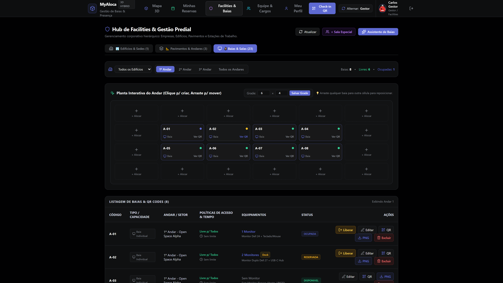
</p>

---

### 4. Hub de Facilities: Gestão de Edifícios & Sedes
> Cadastro e controle multi-sede corporativo, permitindo isolar a operação entre diferentes filiais, endereços e fusos horários.
<p align="center">
  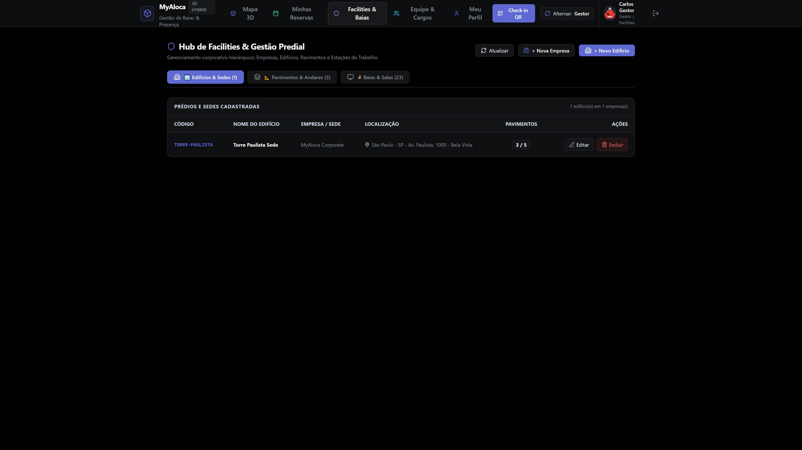
</p>

---

### 5. Hub de Facilities: Pavimentos, Andares & Zonas
> Configuração dos pavimentos e zonas acústicas/operacionais de cada edifício, com dimensões independentes de matriz e plantas ativas.
<p align="center">
  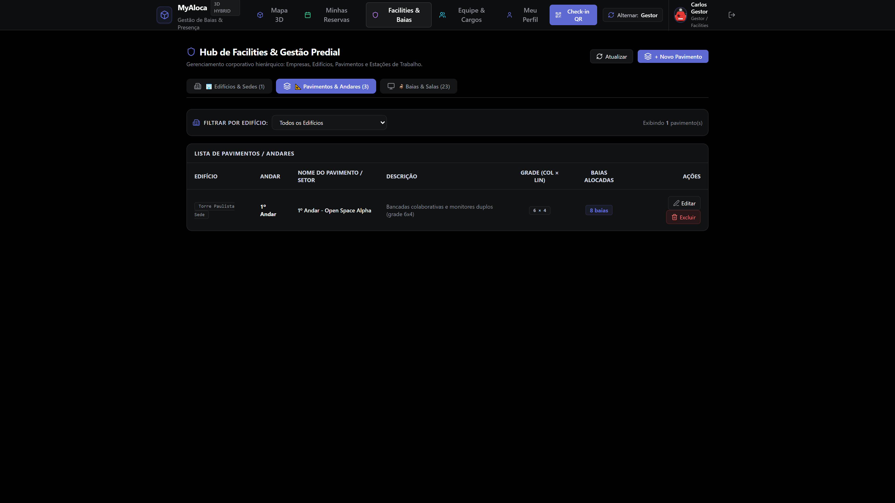
</p>

---

### 6. Gestão de Equipe & Controle de Acesso RBAC
> Tabela administrativa de colaboradores com atribuição granular de papéis (`Admin`, `Gestor`, `Colaborador`), ativação/desativação e visualização de cargos corporativos.
<p align="center">
  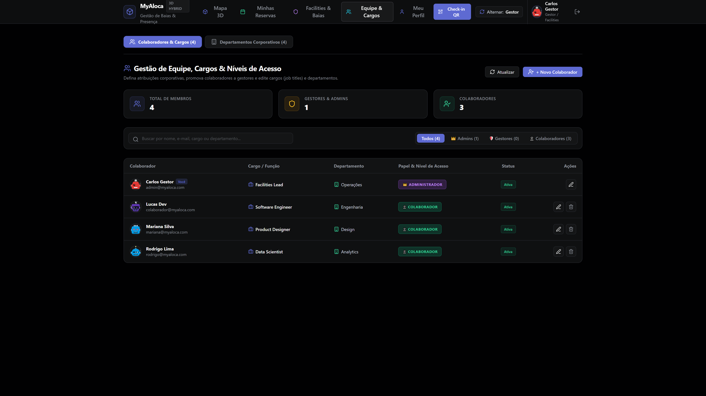
</p>

---

### 7. Gestão Corporativa de Departamentos (CRUD)
> Módulo completo para criação, listagem, edição e exclusão de departamentos (Analytics, Design, Engenharia, Operações, etc.) com contabilização em tempo real de membros associados.
<p align="center">
  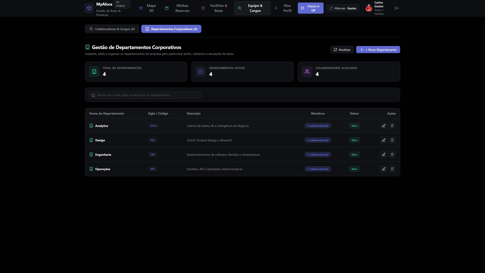
</p>

---

### 8. Adesivos Físicos com QR Code Imutável
> Emissão e exportação de etiquetas físicas prontas para impressão e recorte, contendo hash criptográfico seguro (HMAC-SHA256) para afixação na superfície física da baia.
<p align="center">
  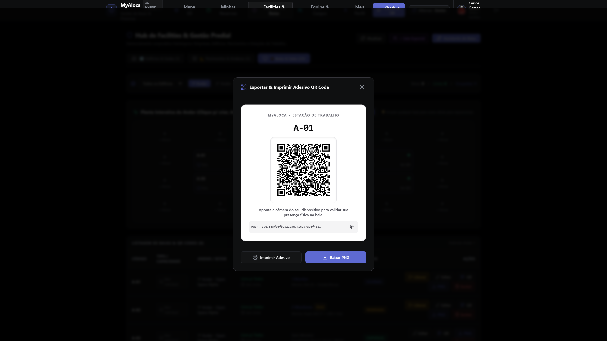
</p>

---

### 9. Scanner Presencial de Check-in
> Validação de presença física no posto de trabalho via câmera com leitor de QR Code integrado ou inserção manual do hash criptográfico da baia.
<p align="center">
  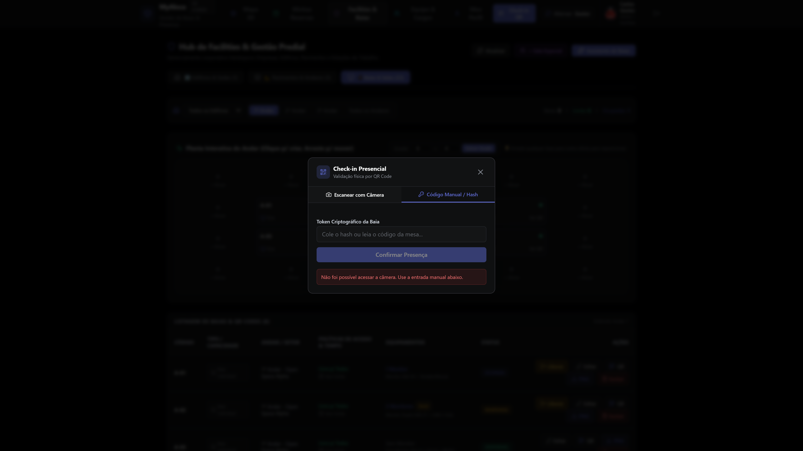
</p>

---

### 10. Perfil do Colaborador & Customização de Avatar
> Gerenciador de perfil com seleção dinâmica de avatares vetoriais estilizados (DiceBear Bottts), garantindo identidade visual clara sobre o gêmeo 3D.
<p align="center">
  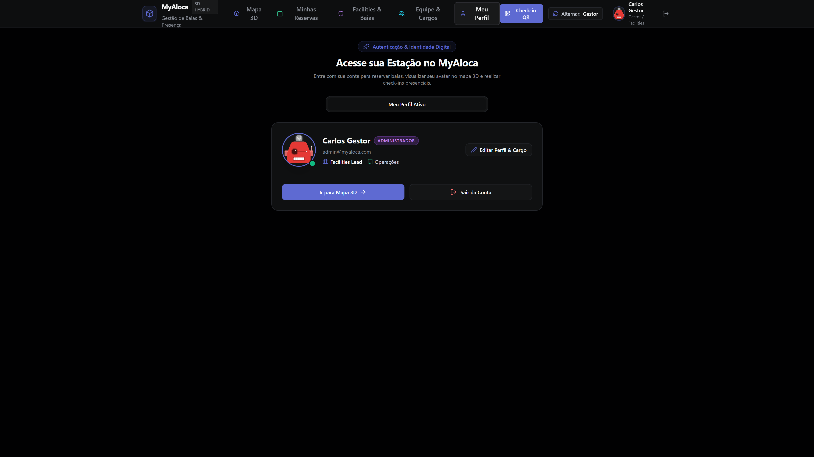
</p>

---

### 11. Minhas Reservas & Liberação Antecipada
> Painel do colaborador exibindo a reserva ativa do dia, contagem regressiva da janela de tolerância de check-in e botão de liberação antecipada para disponibilizar a baia caso o colaborador saia antes do expediente.
<p align="center">
  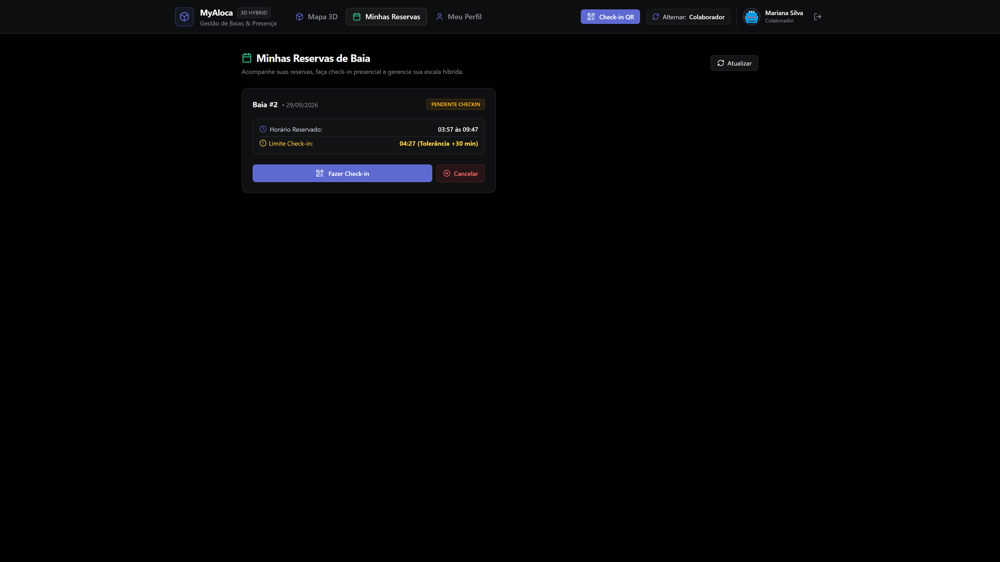
</p>

---

## ⚡ Diferenciais Técnicos

### 🌐 Gêmeo Digital 3D Interativo (Three.js WebGL)
- **Renderização Espacial em Tempo Real**: Cada baia é instanciada com geometria precisa, materiais PBR (mesa, gaveteiro, cadeira ergonômica, monitor e notebook).
- **Indicadores Dinâmicos de Status**: Anéis luminosos com emissão LED na base de cada mesa indicam o estado em tempo real:
  - 🟢 **Verde**: Disponível para reserva imediata.
  - 🟡 **Âmbar**: Reservada, aguardando check-in presencial dentro da janela de tolerância.
  - 🔴/🟣 **Índigo**: Ocupada e confirmada via check-in presencial.
- **Hologramas de Usuário**: Crachás flutuantes em CSS2D/WebGL projetam a foto ou avatar DiceBear do colaborador diretamente acima do posto de trabalho reservado.
- **Controles de Câmera**: Órbita livre, rotação panorâmica, zoom suave e foco automático ao selecionar uma mesa.

### 📐 Matriz 2D Flexível com Algoritmo Adaptativo
- **Dimensões Configuráveis ($M \times N$)**: O gestor pode alterar o tamanho da matriz da planta (ex: de $6 \times 4$ para $8 \times 6$) a qualquer momento.
- **Realocação Automática sem Perda de Dados**: Ao redimensionar a matriz, um algoritmo de projeção proporcional e proximidade espacial reposiciona as baias existentes nas células válidas mais próximas, eliminando a necessidade de reconfigurar ou excluir baias cadastradas.
- **Drag & Drop Físico**: Arraste intuitivo de postos de trabalho no mapa para reordenar o layout das mesas.

### 🔐 QR Code Físico e Prevenção Antifraude
- **Segurança Criptográfica**: Cada baia recebe um hash imutável gerado por HMAC-SHA256, impedindo fraudes ou check-ins remotos.
- **Etiquetas Prontas para Produção**: Modal com linhas de corte para impressão direta ou download em PNG de alta densidade.
- **Scanner Universal**: Leitor web responsivo compatível com câmeras traseiras de smartphones e webcams de notebooks.

### ⏱️ Política de Tolerância & Liberação Antecipada
- **Janela de Tolerância Configurável**: Prazo definido (ex: até 30 minutos após início do turno) para validação do check-in.
- **Cancelamento Automático por No-Show**: Daemon em background (`APScheduler`) audita periodicamente reservas pendentes e libera automaticamente mesas cujos ocupantes não compareceram.
- **Early Release Voluntário**: Colaboradores que encerram o expediente mais cedo podem liberar a baia com um clique em "Liberar Baia Agora", tornando-a disponível para outros integrantes da equipe.
- **Liberação Administrativa**: Gestores e administradores possuem permissão de liberação imediata de qualquer mesa diretamente pelo modal 3D ou pela listagem de baias.

---

## 🏗️ Arquitetura & Tecnologias

```
myaloca/
├── backend/                  # FastAPI (Python 3.12+)
│   ├── app/
│   │   ├── api/              # Endpoints REST (auth, desks, bookings, departments, facilities, users)
│   │   ├── core/             # Configurações, segurança JWT, hash Argon2, regras de negócio
│   │   ├── models/           # Entidades SQLAlchemy (User, Desk, Booking, Floor, Building, Department)
│   │   ├── schemas/          # Schemas Pydantic v2 com validação estrita
│   │   ├── services/         # Serviços de negócio e agendadores (No-Show Daemon)
│   │   └── main.py           # Aplicação FastAPI com lifespan e seed de dados
│   ├── tests/                # Testes assíncronos com pytest e pytest-asyncio
│   └── pyproject.toml        # Dependências gerenciadas via uv / pip
│
├── frontend/                 # Vue 3 + Vite + TypeScript
│   ├── src/
│   │   ├── components/       # Componentes de UI (OfficeCanvas3D, DeskModal, QRScannerModal, etc.)
│   │   ├── views/            # Visões (MapView, MyBookingsView, FacilitiesView, TeamRolesView, ProfileView)
│   │   ├── services/         # Clientes de API Axios/Fetch tipados
│   │   ├── types/            # Interfaces TypeScript
│   │   └── App.vue           # Layout mestre com barra de navegação responsiva
│   └── tailwind.config.js    # Design System corporativo e tema dark
│
├── docs/screenshots/        # Capturas reais de tela em alta definição
└── .specs/                   # Governança Spec Driven Development (SDD) & ADRs
```

### Stack Tecnológica

| Camada | Tecnologia | Propósito |
| :--- | :--- | :--- |
| **Backend** | **Python 3.12 + FastAPI** | API assíncrona de alta performance com documentação OpenAPI automática. |
| **ORM & Database** | **SQLAlchemy 2.0 Async + aiosqlite / asyncpg** | Acesso assíncrono a dados com suporte transparente a SQLite e PostgreSQL. |
| **Autenticação** | **PyJWT + Argon2 (pwdlib)** | Segurança stateless com tokens JWT e hashing de senha de última geração. |
| **Scheduler** | **APScheduler 3.10** | Monitoramento de no-show em background com liberação automática de baias. |
| **Frontend** | **Vue 3 (Composition API / `<script setup>`)** | Interface reativa e modular com tipagem estrita via TypeScript. |
| **Visualização 3D** | **Three.js WebGL + OrbitControls** | Renderização gráfica do escritório em tempo real no navegador. |
| **Estilização** | **Tailwind CSS + Lucide Icons** | Design system profissional com paleta corporativa Slate/Indigo dark. |
| **QR Code** | **HTML5-QRCode + qrcode[pil]** | Leitura de câmera no navegador e renderização de stickers em vetor/raster. |

---

## 🚀 Instalação e Execução

### Pré-requisitos
- **Python 3.12+** instalado
- **Node.js 18+** e **npm** instalados
- Gerenciador de pacotes **uv** (recomendado) ou **pip**

### 1. Clonar o Repositório
```bash
git clone https://github.com/seu-usuario/myaloca.git
cd myaloca
```

### 2. Inicializar o Backend
O backend utiliza SQLite por padrão com migração e seed automáticos dos dados de demonstração no primeiro boot:

```bash
cd backend

# Utilizando uv (rápido e recomendado):
uv sync
uv run uvicorn app.main:app --reload --port 8000

# Ou utilizando venv e pip tradicional:
python -m venv .venv
source .venv/bin/activate  # No Windows: .venv\Scripts\activate
pip install -e .
uvicorn app.main:app --reload --port 8000
```
> A API estará disponível em `http://localhost:8000` e a documentação interativa Swagger em `http://localhost:8000/docs`.

### 3. Inicializar o Frontend
Em outro terminal:

```bash
cd frontend
npm install
npm run dev
```
> O frontend estará rodando em `http://localhost:5173/`.

---

## 🔑 Credenciais de Demonstração

O banco de dados de desenvolvimento é inicializado automaticamente com os seguintes usuários para testes:

| Usuário | E-mail | Senha | Perfil (Role) | Reserva Inicial |
| :--- | :--- | :--- | :--- | :--- |
| **Carlos Gestor** | `admin@myaloca.com` | `admin123` | **Admin / Gestor** | Gestão de facilities, equipe e departamentos |
| **Lucas Dev** | `colaborador@myaloca.com` | `colab123` | **Colaborador** | Baia A-01 (com check-in pendente) |
| **Mariana Silva** | `mariana@myaloca.com` | `mariana123` | **Colaborador** | Baia A-02 (em uso / check-in realizado) |
| **Rodrigo Lima** | `rodrigo@myaloca.com` | `rodrigo123` | **Colaborador** | Sem reserva ativa (disponível para reservar) |

---

## 🧪 Testes e Sensores SDD

O projeto segue rigorosamente o ciclo **Spec Driven Development (SDD)** e possui suíte completa de testes automatizados e sensores de integridade:

### Testes do Backend (Pytest)
```bash
cd backend
uv run pytest -v
```

### Sensor de Integridade SDD
```bash
node .agents/scripts/verify-sdd-integrity.js
```

### Sensor de Spec Drift (Conformidade com Tarefas)
```bash
node .agents/scripts/check-spec-drift.js
```

### Type Checking & Build do Frontend
```bash
cd frontend
npm run build
```

---

## 📄 Licença

Este projeto é distribuído sob a licença **MIT**. Consulte o arquivo [LICENSE](LICENSE) para obter mais informações.

<div align="center">
  <sub>Desenvolvido com foco em excelência arquitetural, inovação em WebGL e experiência fluida para ambientes de trabalho híbridos.</sub>
</div>
